# GLOBISENT

## Global Intelligence Command Center

**One Earth. Every Signal. Unified Intelligence.**

GLOBISENT is a live 3D Earth that brings flights, ships, satellites, disasters, world news, stock markets, companies and local businesses together in one place, from public data sources, with an optional webcam hand-gesture control and a one-click cinematic presentation mode.

It is built on the open-source [GOD'S EYE VIEW](https://github.com/bilawalsidhu/gods-eye-view) engine (CesiumJS, MIT). GLOBISENT adds the command hub, the news, domain, market, company and business services, click-anywhere intelligence cards, hand control and presentation mode on top of it.

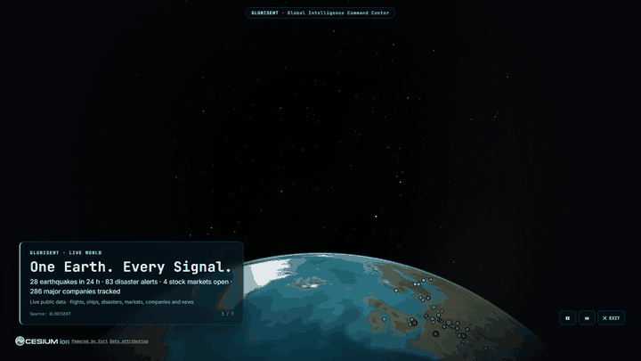

*Presentation mode (`▶ PRESENT`) building a tour from live data: the biggest earthquake of the day, the top disaster alert, the biggest stock-market move and a major company headquarters.*

---

## Features

### 🌍 Live layers on the globe (GOD'S EYE VIEW engine)

Aircraft and military flights, ships (AIS), satellites and launches, earthquakes, wildfires, weather, wind and cyclones, public cameras and street-level imagery, traffic and transit, infrastructure and more. Coverage depends on each provider, region and key.

### 🧭 GLOBISENT hub

| Tab | What it does |
|---|---|
| **News Desk** | Last-24-hour headlines, worldwide or India-focused, in 24 categories, with free-text search. GDELT first, Google News RSS when GDELT is rate-limited. |
| **Markets** | 21 stock exchanges with open/closed status and today's move, plus commodities, currencies, bonds/volatility and crypto. Refreshes every minute. |
| **Companies** | 286 major companies in 20 sectors with full profiles, worldwide company search, every listed company on the globe, and local businesses when zoomed in. |
| **Domains** | 24 information domains (economy, health, defence, science, cyber, agriculture…) with live statistics, headlines, the right map layers and their major companies. |
| **Gestures** | Webcam hand control: pinch and move to grab-rotate the Earth, two-hand pinch to zoom. Mouse, keyboard and touch keep working. |
| **Sources** | Where every signal comes from, and its terms. |

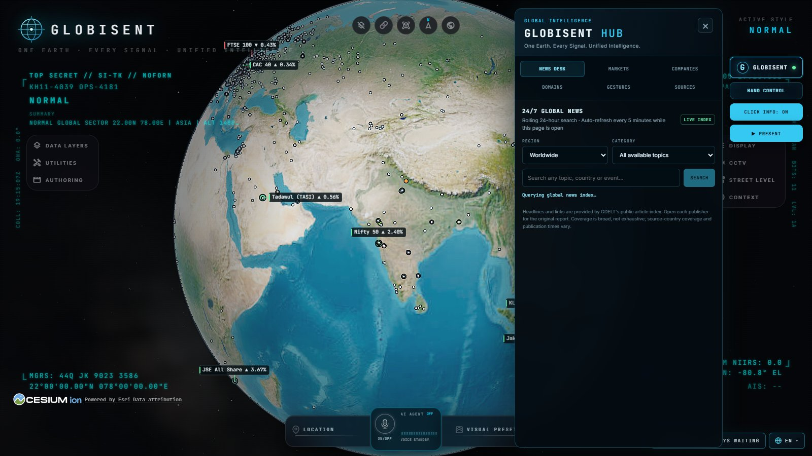

### 📈 World markets

Each exchange is a marker at its city: **green** when its index is up today, **red** when down, a **white ring** when the market is open now. Click one for the index, day and 52-week range, local trading hours, other indices and market news.

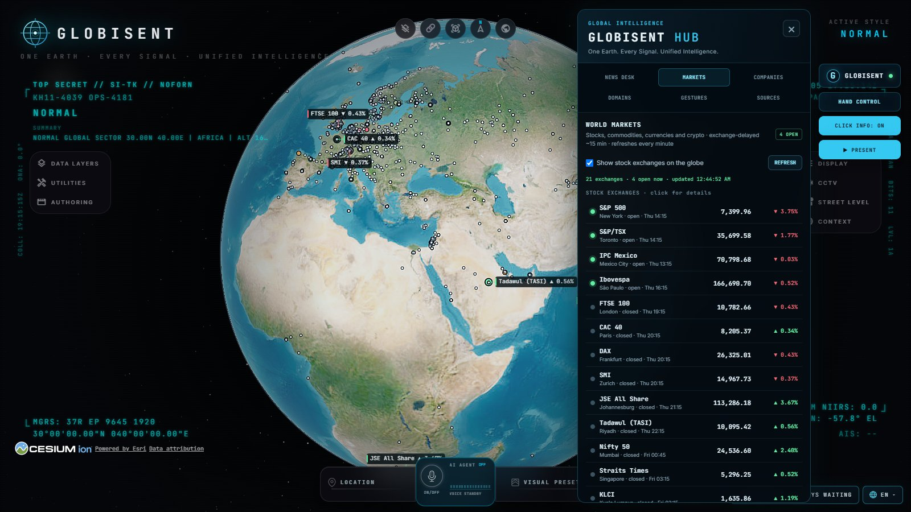

### 🏢 Companies, from the largest to the street corner

| Level | Count | Where |
|---|---|---|
| Major companies with rich profiles | 286 | Coloured markers, by sector |
| Every stock-listed company with a known HQ | 10,798 | White dots; names appear as you zoom in |
| Local businesses (offices, factories, banks, shops, hotels, food, health, fuel) | Loaded per area from OpenStreetMap | Zoom below 9 km over any city |
| Any company with a Wikipedia article | Hundreds of thousands | COMPANIES → SEARCH |

A company profile combines the Wikipedia summary, Wikidata facts (founders, CEO, headquarters, employees, industry, products, subsidiaries, reported financials, stock listing), the live share price and the latest news. A bank branch or shop on the street links to its parent company's profile.

| | |
|---|---|
| 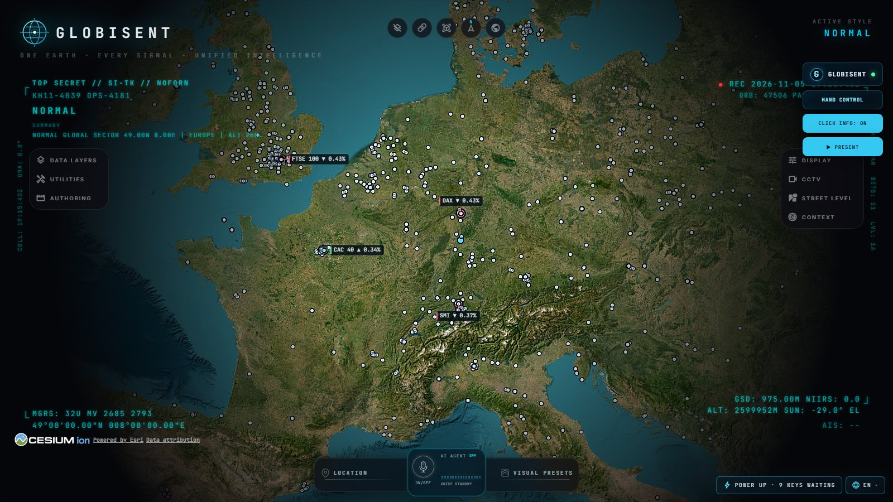 | 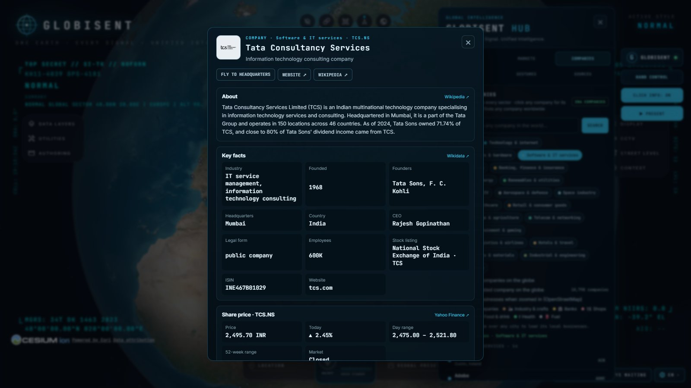 |
| 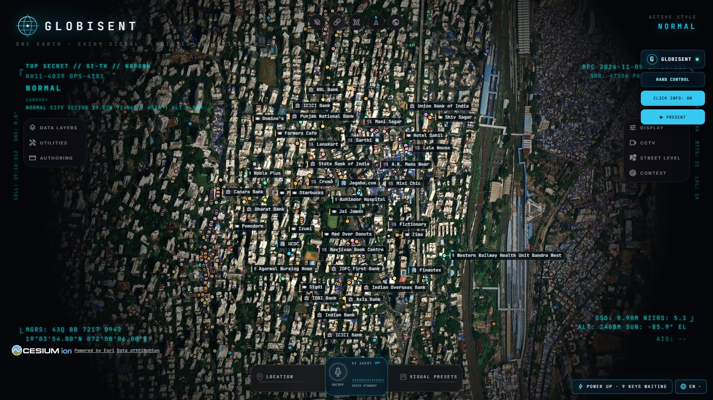 | 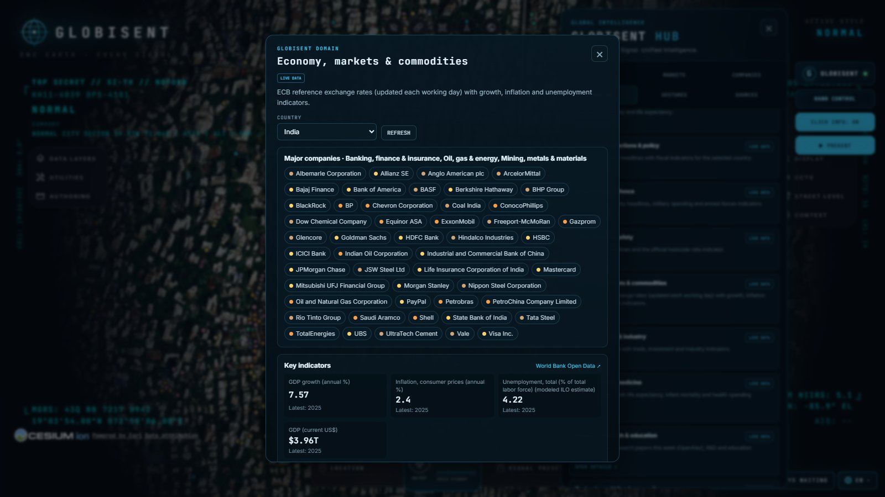 |

### 📍 Click anywhere

Click any point on Earth for an information card: place name, current weather, earthquakes within 500 km, active disaster alerts, the country profile and local news. Click any tracked object (aircraft, ship, camera…) for its own details.

### ▶ Presentation mode

`▶ PRESENT` hides every panel and plays a cinematic tour built from what is happening right now, with a caption card and a pulsing marker at every stop. `Space` pauses, `→` skips, `Esc` exits.

| | |
|---|---|
| 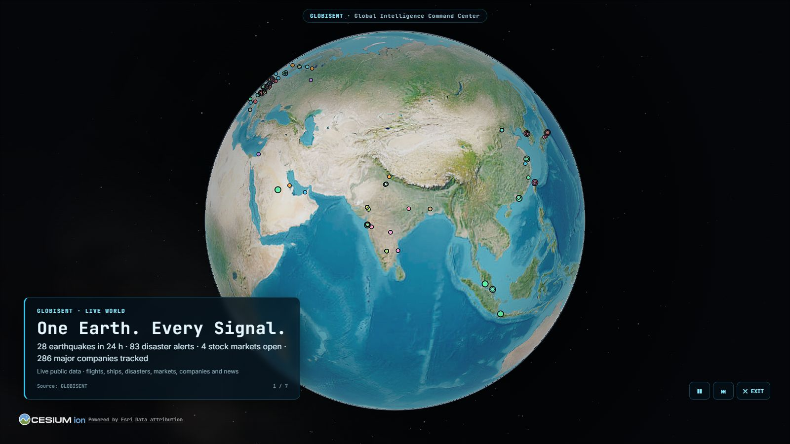 | 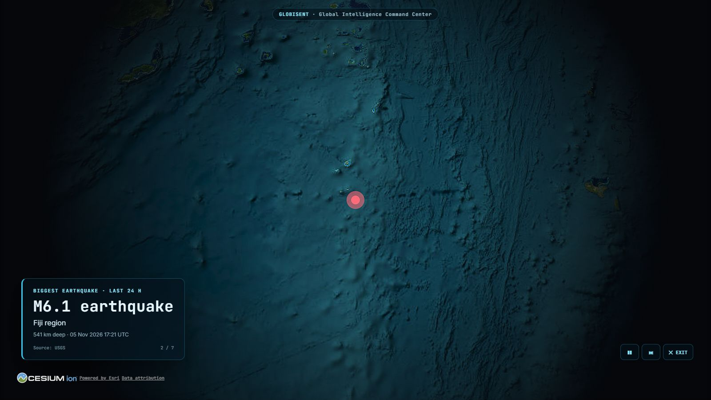 |
| 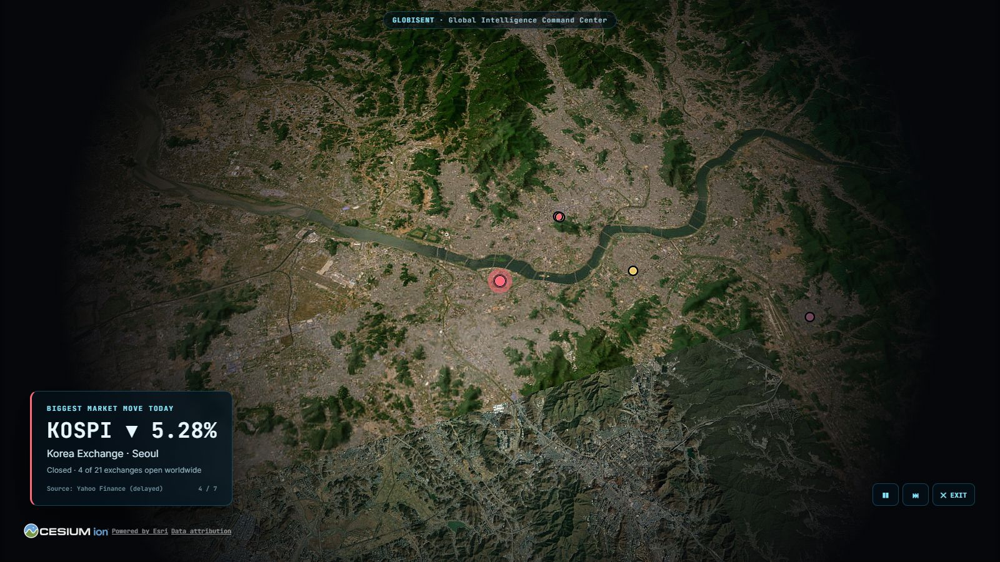 | 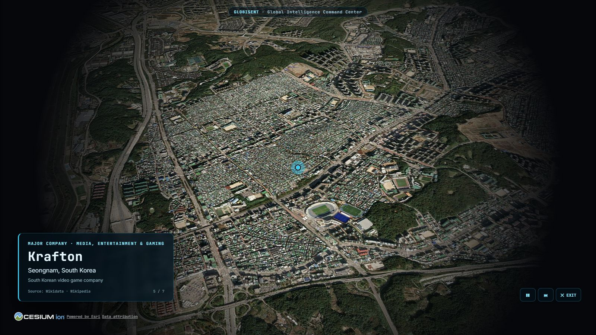 |

---

## How it works

```
Browser (Vue 3 + CesiumJS globe, GLOBISENT hub in src/globisent/)
   │  same-origin /api/* only — no keys in the browser
   ▼
Local Node/Vite server (server/providers/)
   ├─ globisentNews        GDELT DOC 2.0 → Google News RSS fallback
   ├─ globisentDomains     World Bank, ECB (Frankfurter), USGS, GDACS, CISA KEV, OpenAlex
   ├─ globisentPlace       Nominatim, Open-Meteo, USGS, World Bank, news
   ├─ globisentMarkets     Yahoo Finance (delayed), CoinGecko
   ├─ globisentCompanies   Wikipedia, Wikidata Query Service, Yahoo Finance
   ├─ globisentBusinesses  OpenStreetMap via Photon and Nominatim
   ├─ globisentTour        builds presentation stops from the services above
   └─ GOD'S EYE VIEW providers (flights, ships, satellites, weather, cameras…)
```

Every GLOBISENT route caches its answers (many to disk in the git-ignored `.gev-cache/`), respects each provider's rate limits (for example one Nominatim request per second, one GDELT request per five seconds), coalesces identical requests, and falls back to the last good data when a source is down.

---

## Run it

**Requirements:** Node.js 24.14+ or 26.x, a WebGL2 browser (Chrome or Edge), internet access. A webcam is only needed for hand control.

```powershell
npm ci
npm run dev
```

Open the address Vite prints (default `http://localhost:4173`; `npx vite --port 5173` picks another port). On Windows you can also double-click `scripts\windows\Start-GLOBISENT.bat` after `npm ci`.

### Optional keys

Everything above works without keys. Some inherited layers unlock with free or paid keys, saved through the app's **Provider Settings** (or the key box in a domain popup) into a local `.env` that is never committed:

| Key | Unlocks | Cost |
|---|---|---|
| `AISSTREAM_API_KEY` | Live ships worldwide | Free ([aisstream.io](https://aisstream.io/apikeys)) |
| `GOOGLE_MAPS_API_KEY` | Photorealistic 3D cities, place search | Paid, with a free tier |
| `OPENAI_API_KEY` / `GEMINI_API_KEY` | Voice control and HUD summaries | Paid |

If an OpenAI key is rejected, the HUD summary switches itself off until the key changes instead of retrying on every camera move.

---

## Tests

```powershell
node --import=./build/registerVue.js --test src/globisent/*.test.mjs server/providers/globisent*.test.mjs
npm test
```

The GLOBISENT suite covers news fallback, domain feeds, place cards, markets, companies (catalog, profiles, search, listed set, disk cache, polite retries), local businesses, the tour and presentation framing. `npm test` runs the full inherited suite as well.

---

## Data, licensing and privacy

- **Public data, personal use.** Several free sources are for personal or non-commercial use (Yahoo Finance quotes, Google News RSS, the public Photon and Nominatim services). Replace them with licensed or self-hosted providers before any public or commercial deployment. Set `PHOTON_URL` and `NOMINATIM_URL` to use your own OpenStreetMap search instances.
- **Attribution.** Map data © OpenStreetMap contributors (ODbL); company facts from Wikidata (CC0) and Wikipedia (CC BY-SA); earthquakes from USGS; alerts from GDACS; Cesium and imagery credits stay visible on screen, including in presentation mode.
- **Not investment advice.** Market data is exchange-delayed (about 15 minutes) and may be incomplete.
- **Privacy.** GLOBISENT tracks places, organisations and public signals, not people. There is no named-person search or face recognition. Webcam frames for hand control are processed in the browser and never uploaded. API keys stay server-side in `.env`.
- Third-party map imagery, 3D models and bundled datasets have their own licences; review `LICENSE`, `DATA_SOURCES.md` and `THIRD_PARTY_NOTICES.md` before redistribution.

---

## Credits

- **GLOBISENT** created by **Ashwin Lance**.
- Globe engine: [GOD'S EYE VIEW](https://github.com/bilawalsidhu/gods-eye-view) by Bilawal Sidhu (MIT; see `LICENSE`), built on [CesiumJS](https://cesium.com/).
- Hand tracking: [MediaPipe Tasks Vision](https://ai.google.dev/edge/mediapipe), with the gesture approach adapted from the MIT-licensed ULTRON Orb UI by Sagar Tamang (see `LICENSES/ULTRON_ORB_UI_MIT_LICENSE.txt`).
- Data: GDELT, Google News, World Bank, ECB/Frankfurter, USGS, GDACS, CISA, OpenAlex, Open-Meteo, Yahoo Finance, CoinGecko, Wikipedia, Wikidata, OpenStreetMap (Photon, Nominatim) and the providers listed in `DATA_SOURCES.md`.

More documentation: `docs/GLOBISENT_ARCHITECTURE.md`, `docs/GLOBISENT_BUILD_STATUS.md`, `docs/QUICK_START_WINDOWS.md`, `docs/UPSTREAM_GODS_EYE_VIEW_README.md`.
